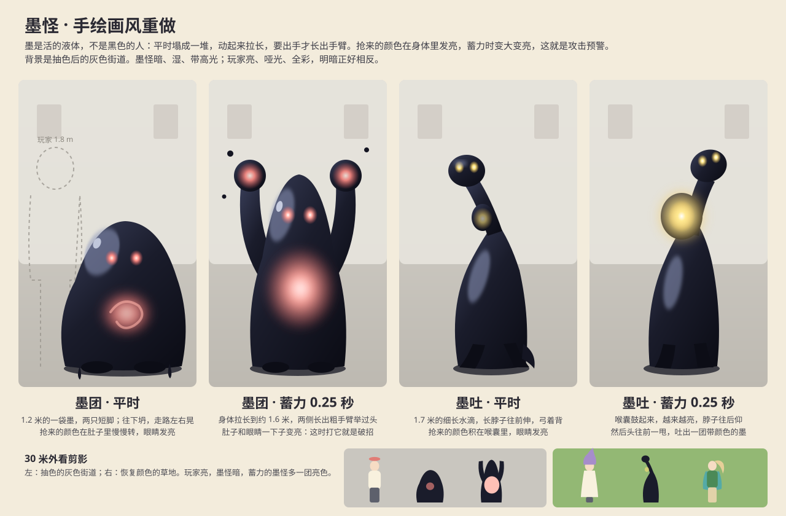

# 重彩 Inkbloom

世界本来是彩色的。墨潮把颜色抽走，留下黑白线稿；玩家把颜色还回来，或者按自己的想法重新涂。

浏览器第一人称游戏，PC 键鼠。无限野外，城镇就建在野外的地形上，吉卜力式手绘动画画风。

## 运行

需要 Node.js 20.15+ 和支持 WebGL 2 的桌面浏览器。

```sh
npm install
npm run dev
```

打开 <http://127.0.0.1:5190>。地址参数：`?world=<存档名>` 选存档槽，`?seed=<整数>` 指定新世界种子。存档在浏览器 localStorage。

```sh
npm run check   # 类型检查 + 测试 + 格式检查 + 生产构建
npm test        # 只跑测试
```

### 联机（最多 10 人）

开服的人运行世界服务器，其他人打开游戏，在主菜单点"联机"填开服那台电脑的地址（或者地址栏加 `?server=<地址>:5195`，第一次会先问一句要不要加入）：

```sh
INKBLOOM_PASSWORD=暗号 npm run server                 # 世界 default，端口 5195，最多 10 人，要密码
npm run server -- --world 周末 --port 5195 --max 10   # 换世界名、端口、人数
npm run server -- --origin https://my.site           # 游戏页面放在别的网站上时，允许它连进来
```

- **建议设密码**（环境变量 `INKBLOOM_PASSWORD`，不放在命令行里，免得同一台机器上的其他人看到）。不设密码时，能连到这个端口的人都能进来。
- 只有本机和局域网地址上打开的游戏页面能连进来，别的网站上的页面会被拒绝（`--origin` 可以放行指定网站）。
- 世界和每个人的进度存在 `world-data/<世界名>.json`。每个服务器上你都有一个单独的身份，别的服务器拿不到。

现在是联机第一阶段：互相看得见（带手里的武器或笔刷，挥刀、开枪、上色都有动作）、世界进度共享、时间天气一致；竞技场里可以 PvP（混战或组队，服务器判定命中）。野外还不能互相攻击，墨怪还是每个人各算各的。见 [docs/roadmap.md](docs/roadmap.md)。

## 操作

| 按键                | 作用                                                              |
| ------------------- | ----------------------------------------------------------------- |
| WASD / 空格 / Shift | 移动 / 跳（二段跳；有纸飞机后在空中按住滑翔）/ 冲刺               |
| E / F               | 交互 / 第二个动作（画室升级笔刷、在已恢复的城和墨迹标记之间传送） |
| 1 / 2 / 3           | 笔刷 / 武器 / 墨迹标记                                            |
| 左键 / 右键         | 还色、攻击、放标记 / 切换修复与涂鸦、装弹、狙击瞄准、收回标记     |
| Q / R / 滚轮        | 换颜色或换武器                                                    |
| G                   | 武器技能                                                          |
| Tab                 | 角色：分配属性点                                                  |
| Esc                 | 暂停菜单（设置、操作说明、回主菜单）                              |
| F2 / F3             | 自由飞行 / 调试面板                                               |

## 当前进度：首版范围已完成

- 野外：4 个群系的平滑起伏地形（缓坡草地、绿色山丘、陡处露出岩石）、树、河，按区块流式加载；颜色随附近城市进度派生
- 水域：浅滩可涉水，进入深水自动游泳，按 Shift 加快划水。河湖里的鱼群会避开玩家，鱼尾和划水都会留下波纹。浅滩的扇贝按 E 采集可得颜料，并解锁米白蜡笔。
- 城镇：每 7×7 区块一座，站在格子中间，脚下地面整平、四周 60 米缓坡接回山丘；主城门朝向世界原点，第一座就在出生点东边河对岸。走过城门直接进城，不用读条、不用传送；城镇走近时在后台线程预先建好
- 城镇布局：按地形生长的村镇——城里保留一半的地势起伏；先在最平的地方定广场，再从各城门按"爬坡代价最低"的路线修主街到广场（街道会绕着山坡弯过去），然后从街上分出小巷通到镇子各处；房子沿街两侧排开、面朝街道，坐在找平的石台基上，坡陡处门前有台阶；街道之间剩下的空地是可以上色的庭院。全部从种子和地形确定性生成
- 笔刷：修复（还原色）与涂鸦（用找到的蜡笔选色），两种都花同一种颜料，按表面计
- 存档：每表面一字节状态 + 补丁式写入，退出重进保留
- 颜料循环：野外花田 / 浆果丛 / 矿脉 / 芦苇丛采集颜料和墨（10 分钟长回来，首次采到新颜色解锁蜡笔）；城里路上的墨渍走过去就吸走；画室把墨提炼成颜料。资源只有两种：颜料和墨（门口最近的画室一开始就开门，其他街区有色 70% 后开门）
- 街区与墨潮：每个街区按有色比例分为 抽色 / 清理中 / 有色 / 繁荣；清理中的街区挨着抽色街区会慢慢褪色；每 8–12 分钟一次墨潮，提前 30 秒预警，墨帘从抽色一侧推进，对准墨帘按住左键用颜料推回，守住有奖励
- 完整一轮：出生点旁的第一座城是 2×2 小城，靠城里的墨渍加一趟野外采集就能涂完；全部街区有色即恢复（奖励颜料和墨，周围野外重新上色），然后去下一座城
- 成长：画室按 F 升级笔刷（更远、更快）
- 目标提示：目标变化时左上角淡入一行短句，带方向箭头和距离，几秒后隐去，按 J 再看；界面平时只留准星，信息需要时才出现，教学提示只出现头一两次
- 战斗：2 号工具是步枪；抽色街区有墨怪据点（墨团近身咬、墨吐远程吐墨）；最灰的野外和一些墨潮里有墨巨（高大、皮厚，只有狙击枪和榴弹炮打得断它的砸击）；野外和墨潮里还有墨鼬（矮小、快，伏低蓄力后直线扑过来，看它伏下时横跨一步就能躲开），据点没清空的街区不能上色；墨潮会带墨怪来；打败墨怪得墨。被打倒会在原地掉一半墨（红旗标记，走过去捡回），在城门复活
- 传送：两座以上已恢复的城之间，在城门按 E 依次传送
- 寻路：墨怪看不见你时沿网格 A* 绕路追过来（城市按道路和庭院、野外按地面高差，树和房屋挡路）
- 野外墨怪：越灰的地方越多，城市恢复后附近就不再出现；打败给墨，15 分钟后回来。在野外倒下会回到最近的已恢复城镇的主街，没有就回世界出生点
- 成长：经验和 1–10 级，里程碑给属性点（生命 / 武器强度 / 技能强度 / 防护），Tab 加点
- 野外遗迹（石圈、旧桥人家、碑林、山神小祠、古井驿站）：走近拿到新颜色的蜡笔；城镇街巷采用农舍、乡村小铺和谷仓三种屋型
- 居民心愿：每个街区 1–2 位居民想要房子换个颜色或要几份某种颜色的颜料（要先有那支蜡笔）；街区有色且心愿都完成就"繁荣"，画室每 5 分钟产出颜料
- 纸飞机（恢复第一座城后得到）与墨迹标记（野外最多 3 个，加入传送环）
- 五种武器：步枪、武士刀、狙击枪、榴弹炮、墨能法杖，各带一个技能（G），随成长解锁
- 菜单：开始菜单（继续、新世界、世界列表、设置、操作说明）、暂停菜单、设置（灵敏度、视野、画质）
- 声音与反馈：录音素材（全部 CC0：Kenney 音效、野外录音的环境声、Komiku 的音乐，出处见 `public/sounds/CREDITS.md`），每个声音都有程序合成的备用版本，文件缺失或还没加载完时用合成的——笔刷沙沙声、上色的音阶、各武器的枪声、墨怪受击和死亡、爆炸、墨潮号角和低频轰鸣、脚步、滑翔风声；音乐随周围颜色变化（灰的地方稀疏小调、彩色的地方明亮大调，墨潮时加紧张的脉冲）；上色时迸出那个颜色的碎片、墨怪溅墨、爆炸、墨帘滴墨、受伤和爆炸震屏。设置里有总音量、音乐、音效
- 伤害显示：打中墨怪飘伤害数字（大伤害金色、击杀红色），墨怪头上短暂显示血条；自己受伤时血条旁出红字（护盾吸收的单独显示），并有箭头指向攻击来的方向
- 墨怪和墨潮都是实心的黑墨（调色板的 `solid` 颜色），和抽色后的铅笔灰区分开。墨怪是活的湿墨：墨团是一袋墨，平时塌成一堆，出手时身体拉长、从两侧长出手臂；墨吐是细长的水滴形，长脖子，喉咙上有个囊；它们身上带着抢来的颜色（眼睛、肚子或喉囊、拳头），据点墨怪带着所占街区原本的颜色，野外墨怪带着当地的颜色，被打倒时化成一摊墨，颜色飘散出来。攻击会先蓄力（墨团变高、举起长出来的手臂，墨吐的喉囊鼓起来变亮），能看准了躲

  

- 画风：吉卜力式手绘动画背景，没有描边。暖色日光、偏蓝的阴影、草和树叶上斑驳的笔触与光斑、蓝绿色天空和积云、远处的雾；树冠是一簇簇笔触画出的叶团（宽冠阔叶树和高高的杉树），水面倒映天空、泛着波光，天边有层层淡蓝的远山，风吹过草地时亮带一道道滚过，野花一片片地开；整个画面再过一遍笔触滤镜和画作调色，像一幅油画；草地是一片片带穗子的细茎，城里的房子有窗户和坡屋顶；野外脚边有随风摆动的草和野花。抽色的地方是同一幅画褪成浅灰。墨潮来袭时整个画面褪成黑白，墨从屏幕边缘渗进来，墨潮结束后颜色慢慢回来。界面是贴着纸胶带的米色纸卡、手撕纸条的颜料色块按钮、毛笔字标题
- 光影：一天 24 分钟（`TUNING.day`）。太阳从东升到西，影子跟着转、傍晚拉长变成金色，黄昏转紫，夜里是月光下的蓝色，满天星星，恢复了颜色的街道窗户亮起灯。房子、树、墨怪都投下实时阴影
- 打怪和心愿直接还色：打倒据点墨怪，它守的地方附近 14 米内最多 10 个抽色表面恢复原色；完成居民心愿，门口 18 米内最多 24 个表面恢复。打倒墨潮带来的墨怪，墨帘退回 6 米，退到边缘就算守住，不花颜料也能打退墨潮。数值在 `tuning.ts` 的 `release` 和 `tide.monsterKnockBack`
- 试玩报告：游戏在本地记下每个街区花了多久、颜料收支、战斗、墨潮和卡住的地方，暂停菜单"导出试玩报告"下载成 Markdown，发给开发者调数值

正在做 V3 联机大世界：野外探索和玩家 PK 是主线，城市是组队副本。已经有：最多 10 人的世界服务器、六个可选的玩家角色（第一次开始前选，联机时别人看得到）、竞技场 PvP；还没有：野外 PvP、占遗迹、组队副本（开发时 `inkbloom.lineup()` 能在镜头前看到角色和墨怪）。设计见 [docs/game-design.md](docs/game-design.md)，顺序见 [docs/roadmap.md](docs/roadmap.md)。

## 文档

- [docs/architecture.md](docs/architecture.md) —— 代码分层与数据流，先读这个
- [docs/EXTENDING.md](docs/EXTENDING.md) —— 改数值、加颜色、加群系、加工具……的具体步骤
- [docs/game-design.md](docs/game-design.md) —— 玩法设计（V3：探索、PK、打击感、副本、联机、玩家角色）
- [docs/world-generation.md](docs/world-generation.md) —— 世界生成算法
- [docs/roadmap.md](docs/roadmap.md) —— 下一步
